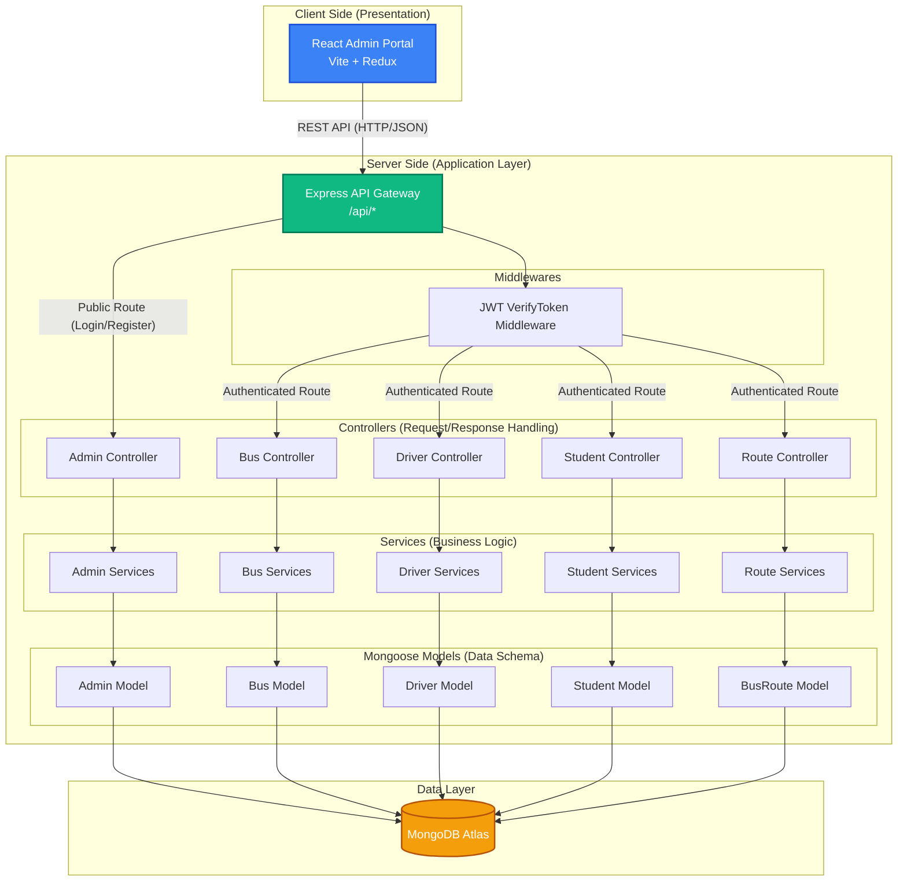
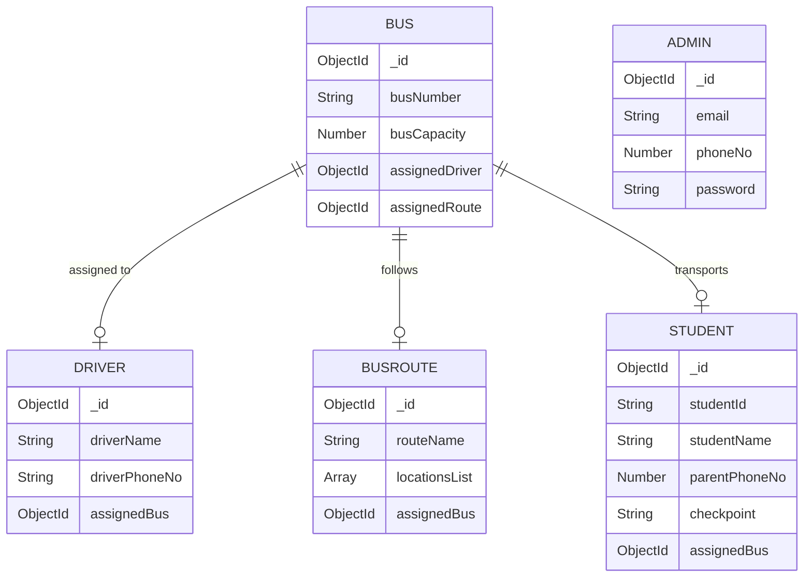

# Bus Guardian System Architecture

This document provides a high-level architectural view of the Bus Guardian system. It outlines how the frontend communicates with the backend, and how the backend is structured into distinct functional layers.

## High-Level System Architecture

The system follows a standard **3-Tier Architecture**:
1. **Presentation Layer (Frontend)**: A React-based Single Page Application (SPA) providing the user interface for administrators.
2. **Application Layer (Backend)**: A Node.js and Express server handling API requests, business logic, and authentication.
3. **Data Layer (Database)**: A MongoDB database storing application state and entities.

## Data Entity Relationships

The entities in the database are highly relational. Understanding these relationships is crucial to understanding the business logic.

## Backend Layer Responsibilities

1. **Routes (`/routes`)**: Maps specific HTTP verbs (GET, POST, PUT, DELETE) and URL paths to their respective Controller functions. It also attaches the `VerifyToken` middleware to protected endpoints.
2. **Controllers (`/controllers`)**: The entry point for business logic. They extract data from incoming HTTP requests (`req.body`, `req.params`), pass it to the Services, and format the HTTP response (status codes and JSON payload) to send back to the client.
3. **Services (`/services`)**: Contains the core business logic. This layer performs validations, data formatting, and cross-model interactions (e.g., when a Driver is assigned to a Bus, the Service updates *both* the Driver and Bus collections). This abstracts logic away from the controller, ensuring it can be reused easily.
4. **Models (`/models`)**: Defines the Mongoose schemas. They dictate the exact structure of a document in MongoDB, providing built-in type validation and relationship references.
5. **Utilities (`/utility`)**: Helper functions used globally across the backend, such as JWT token generation/verification, bcrypt password hashing, and fetching geolocation coordinates.
